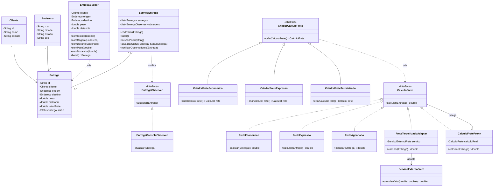

# EasyFrete — Arquitetura e Modelagem

## 1. Visão arquitetural

A aplicação será organizada em módulos com responsabilidades específicas, utilizando pacotes Java para separar as classes de domínio, serviços e implementações dos padrões de projeto.

A arquitetura deverá priorizar:

- Alta coesão.
- Baixo acoplamento.
- Encapsulamento.
- Separação de responsabilidades.
- Facilidade de manutenção e expansão.
- Utilização de abstrações para permitir flexibilidade.

## 2. Modelagem inicial do domínio

### 2.1. Cliente

Representa o cliente responsável pela solicitação de entrega.

Atributos:
- id
- nome
- contato

Responsabilidades:
- Armazenar os dados básicos do cliente.
- Disponibilizar suas informações para identificação nas entregas.

### 2.2. Endereco

Representa um endereço de origem ou destino.

Atributos:
- rua
- cidade
- estado
- cep

Responsabilidades:
- Armazenar informações de localização.
- Fornecer os dados necessários para identificar os locais de coleta e entrega.

### 2.3. Entrega

Representa uma solicitação de transporte.

Atributos:
- id
- cliente
- origem
- destino
- peso
- distancia
- valorFrete
- tipoEntrega
- status
- observacoes
- dimensoes

Responsabilidades:
- Armazenar os dados da solicitação.
- Disponibilizar suas informações.
- Manter o estado atual da entrega.

Os atributos observacoes e dimensoes serão opcionais.

### 2.4. ServicoEntrega

Responsável por coordenar as operações relacionadas às entregas.

Responsabilidades:
- Cadastrar entregas.
- Consultar entregas.
- Listar entregas.
- Atualizar o status.
- Acionar as notificações quando houver alterações.

As informações serão mantidas em uma coleção em memória.

## 3. Modelagem dos Design Patterns

### 3.1. Factory Method

Pacote: factory

Interfaces e classes previstas:

- CriadorCalculoFrete (classe abstrata).
- CriadorFreteEconomico.
- CriadorFreteExpresso.
- CriadorFreteTerceirizado.

O método de fábrica será responsável por fornecer a estratégia de cálculo correspondente à modalidade selecionada.

A inclusão de novas modalidades deverá permitir a criação de novos criadores sem modificar os existentes.

### 3.2. Builder

Pacote: builder

Classe prevista:

- EntregaBuilder.

Será responsável por construir objetos Entrega progressivamente.

Deverá permitir configurar os atributos obrigatórios e opcionais antes da construção do objeto final.

### 3.3. Adapter

Pacote: adapter

Classes previstas:

- ServicoExternoFrete.
- FreteTerceirizadoAdapter.

A classe ServicoExternoFrete simulará uma biblioteca externa com uma interface própria.

A classe FreteTerceirizadoAdapter implementará a interface interna CalculoFrete e converterá as chamadas para o formato esperado pelo serviço externo.

### 3.4. Proxy

Pacote: proxy

Classe prevista:

- CalculoFreteProxy.

Implementará a mesma interface utilizada pelo serviço de cálculo.

Será responsável por validar os dados da solicitação antes de encaminhar a operação ao objeto real.

O Proxy poderá envolver tanto uma estratégia interna quanto o Adapter.

### 3.5. Strategy

Pacote: strategy

Interface:

- CalculoFrete.

Implementações:

- FreteEconomico.
- FreteExpresso.
- FreteAgendado.

Cada implementação possuirá seu próprio algoritmo de cálculo.

A aplicação utilizará a interface CalculoFrete para trabalhar com as diferentes estratégias sem depender diretamente de suas classes concretas.

### 3.6. Observer

Pacote: observer

Interface:

- EntregaObserver.

Implementações:

- EntregaConsoleObserver.

O ServicoEntrega atuará como publicador de eventos.

Quando o status de uma entrega for atualizado, os observadores registrados receberão uma notificação.

Nesta versão, a notificação será simulada por mensagens exibidas no console.

## 4. Diagrama de classes UML

O diagrama abaixo representa a arquitetura planejada, incluindo as principais classes e os relacionamentos dos padrões.



Observação: o diagrama representa a arquitetura planejada. Os relacionamentos poderão ser ajustados durante a implementação.

## 5. Aplicação dos princípios GRASP

### 5.1. Information Expert (Especialista na Informação)

As responsabilidades serão atribuídas às classes que possuem as informações necessárias para executá-las.

Exemplo:
- Entrega conhece seus próprios dados e status.
- Endereco conhece suas informações de localização.
- Cada implementação de CalculoFrete conhece as regras do seu próprio algoritmo.

### 5.2. Creator (Criador)

A responsabilidade pela criação dos objetos será atribuída de acordo com a relação entre as classes.

Exemplos:
- EntregaBuilder será responsável pela construção de objetos Entrega.
- Os criadores concretos do Factory Method serão responsáveis pela instanciação das estratégias de cálculo.

### 5.3. Controller (Controlador)

O ServicoEntrega atuará como controlador das operações relacionadas ao gerenciamento de entregas.

Ele receberá as solicitações da aplicação e coordenará as operações necessárias, evitando concentrar toda a lógica na classe Main.

### 5.4. Low Coupling (Baixo Acoplamento)

As classes deverão depender preferencialmente de interfaces e abstrações, evitando dependências diretas desnecessárias entre implementações concretas.

Exemplos:
- O Proxy dependerá da interface CalculoFrete.
- O Adapter implementará CalculoFrete.
- O sistema utilizará a abstração CalculoFrete para executar os cálculos.

### 5.5. High Cohesion (Alta Coesão)

Cada classe deverá possuir responsabilidades bem definidas.

Exemplos:
- Entrega representa os dados de uma solicitação.
- CalculoFrete define o contrato para os algoritmos.
- EntregaBuilder constrói objetos Entrega.
- EntregaConsoleObserver apresenta notificações.
- CalculoFreteProxy controla o acesso ao serviço.

### 5.6. Polymorphism (Polimorfismo)

O polimorfismo será utilizado principalmente no módulo de cálculo de frete.

Diferentes implementações de CalculoFrete poderão ser utilizadas por meio da mesma interface, permitindo que o comportamento varie conforme a modalidade selecionada.

### 5.7. Indirection (Indireção)

Os padrões Adapter e Proxy introduzirão intermediários entre a aplicação e o serviço externo.

Esses intermediários permitirão adaptar interfaces e controlar o acesso sem modificar diretamente os componentes envolvidos.

### 5.8. Protected Variations (Variações Protegidas)

As partes do sistema sujeitas a mudanças serão protegidas por abstrações.

Exemplos:
- A interface CalculoFrete protege o restante do sistema das variações nos algoritmos de cálculo.
- A interface EntregaObserver protege o publicador das diferentes implementações de observadores.
- O Adapter protege a aplicação das particularidades da interface externa.

## 6. Organização dos pacotes

Estrutura planejada:

```text
src/
└── easyfrete/
    ├── Main.java
    │
    ├── model/
    │   ├── Cliente.java
    │   ├── Endereco.java
    │   └── Entrega.java
    │
    ├── enums/
    │   ├── StatusEntrega.java
    │   └── TipoEntrega.java
    │
    ├── service/
    │   └── ServicoEntrega.java
    │
    ├── builder/
    │   └── EntregaBuilder.java
    │
    ├── factory/
    │   ├── CriadorCalculoFrete.java
    │   ├── CriadorFreteEconomico.java
    │   ├── CriadorFreteExpresso.java
    │   └── CriadorFreteTerceirizado.java
    │
    ├── strategy/
    │   ├── CalculoFrete.java
    │   ├── FreteEconomico.java
    │   ├── FreteExpresso.java
    │   └── FreteAgendado.java
    │
    ├── adapter/
    │   ├── ServicoExternoFrete.java
    │   └── FreteTerceirizadoAdapter.java
    │
    ├── proxy/
    │   └── CalculoFreteProxy.java
    │
    └── observer/
        ├── EntregaObserver.java
        └── EntregaConsoleObserver.java
```

## 7. Considerações arquiteturais

A arquitetura deverá permanecer simples e adequada ao escopo acadêmico.

Não serão utilizadas camadas ou abstrações adicionais sem necessidade.

O sistema deverá priorizar a compreensão das responsabilidades, a correta aplicação dos padrões e a integração entre os componentes.